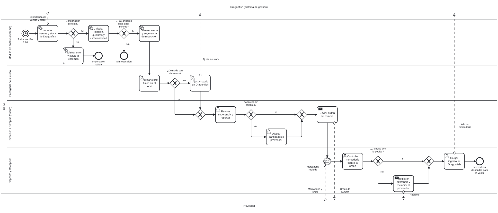

# Módulo de Análisis y Reportes de Compras · Olí Ali

**Trabajo Práctico Integrador y Progresivo (TPI)** · Organización Empresarial
Tecnicatura Universitaria en Programación a Distancia · Universidad Tecnológica Nacional

| | |
|---|---|
| **Integrante** | Mateo Carlos Olivero (trabajo individual) |
| **Docente titular** | Carolina Bruno |
| **Docente tutor** | Francisco Varberde |
| **Tablero de gestión** | [GitHub Projects · Olí Ali – Módulo de compras](https://github.com/users/mateoolivero/projects/1) |

## Descripción del sistema

Olí Ali es una tienda multimarca de indumentaria de Córdoba con cuatro sucursales: Núñez, Estrada, Pueyrredón y 9 de Julio. Gestiona sus ventas y su stock con **Dragonfish**, que no tiene herramientas de análisis. Por eso las compras a proveedores se deciden "a ojo" y dependen solo del dueño.

Este proyecto documenta el diseño de un **módulo de análisis y reportes** que todos los días importa las ventas y el stock de Dragonfish, calcula la rotación, los quiebres, la estacionalidad y el rendimiento por proveedor, y genera alertas y sugerencias de reposición. Así, la compra pasa a basarse en datos objetivos y se cierra el ciclo de retroalimentación entre ventas y compras.

**Stack previsto:** Python (importación y procesamiento) · Supabase/PostgreSQL (base de datos) · Next.js (tablero de reportes).

## Contenido del repositorio

| Carpeta / archivo | Contenido |
|---|---|
| [`docs/entrega-1-organizacion-sistemica.md`](docs/entrega-1-organizacion-sistemica.md) | Caso de estudio, misión, visión, modelo TGS y módulo propuesto |
| [`docs/entrega-2-diagnostico-y-planeacion.md`](docs/entrega-2-diagnostico-y-planeacion.md) | FODA, objetivo, metas cuantitativas y planificación |
| [`docs/entrega-3-estructura-y-datos.md`](docs/entrega-3-estructura-y-datos.md) | Organigrama y diccionario de datos |
| [`docs/entrega-4-procesos-y-control.md`](docs/entrega-4-procesos-y-control.md) | Proceso BPMN, flujo de trabajo en Git e indicadores de control |
| [`backlog/historias-de-usuario.md`](backlog/historias-de-usuario.md) | Las tres historias de usuario del backlog |
| [`diagramas/`](diagramas/) | BPMN 2.0 (`.bpmn` y `.svg`), organigrama y modelo de sistema abierto |

## Proceso principal

## Flujo de trabajo

- `main` solo recibe cambios mediante **Pull Request** revisado.
- Cada bloque de trabajo se desarrolla en una **rama secundaria** (`docs/...`).
- Los commits siguen *Conventional Commits* en español: `docs(bpmn): agregar modelo del proceso de reposición`.
- Los PR cierran los *issues* del tablero con `Closes #n`, y la tarjeta pasa sola a **Listo**.

## Declaración de uso de IA

Usé **Claude** (Anthropic) como asistente durante las cuatro entregas. En la Entrega 1 también usé **ChatGPT** para preparar las preguntas de la entrevista al dueño, Matías Flores. La información sobre Olí Ali salió de esa entrevista y de mi trabajo diario en la empresa, no de la IA.

### Prompts utilizados y por qué

| Entrega | Prompt (resumido) | Por qué lo planteé así |
|---|---|---|
| 1 | "Armame preguntas para entrevistar al dueño sobre misión, visión, clientes y procesos" | No quería que la IA inventara la misión: le pedí preguntas y las respuestas las dio el dueño. |
| 2 | "Con la Entrega 1 y el material de la Unidad 4, ayudame a organizar el FODA, las estrategias cruzadas y el Gantt" | Le pasé la entrega anterior como contexto para que el FODA hablara del proyecto real y no de un caso genérico. |
| 3 | "Ayudame con esta tarea" + consigna + Entregas 1 y 2 | Al adjuntar las entregas anteriores, el organigrama y el diccionario quedaron alineados con el módulo y con las metas. |
| 3 | "Hay más sucursales: Estrada, Pueyrredón y 9 de Julio" | Corrección mía (ver abajo). |
| 4 | "Ayudame a realizar el TP 4 y consolidar las 4 entregas" + consigna + entregas | Le pedí que derivara los indicadores de las metas de la Entrega 2 y de los campos de la Entrega 3, para que el control fuera medible con datos que el sistema realmente guarda. |

### Correcciones humanas sobre los resultados

- **Sucursales inventadas.** En la primera versión del organigrama la IA supuso un "Local Casa Central" y una sola sucursal. Lo corregí con las cuatro sucursales reales.
- **Meta inconsistente.** Al corregir las sucursales apareció que la meta de escalabilidad de la Entrega 2 ("hasta 3 sucursales") ya era menor que la realidad. La subí a **al menos 6 sucursales** y lo dejé documentado.
- **Supuestos sobre la estructura.** Revisé que la Dirección y Compras las ejerce el dueño y que la asesoría contable es externa. Esos datos los validé yo; la IA no los tenía.
- **Campos de Dragonfish.** El diccionario es preliminar: los nombres de campo pueden cambiar cuando confirme qué exporta Dragonfish.
- **Estados del tablero.** La IA propuso los estados; los ajusté al avance real del Gantt, y solo marqué como "Listo" lo que efectivamente terminé.

### Criterio

Usé la IA para estructurar, diagramar y revisar la redacción. Las decisiones del proyecto (qué módulo construir, qué medir, plazos y prioridades) y la veracidad de los datos de Olí Ali son mi responsabilidad.
