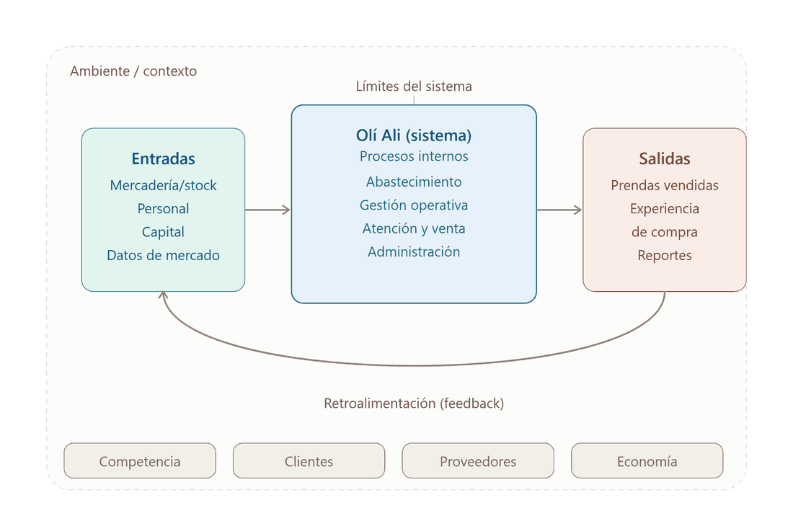

# Entrega 1 · La organización y su enfoque sistémico

## Caso de estudio

**Olí Ali** es una tienda multimarca de indumentaria de Córdoba para mujeres de todas las edades, niños y bebés. Opera con cuatro sucursales (Núñez, Estrada, Pueyrredón y 9 de Julio) y presencia digital de apoyo. Sector: comercio minorista de indumentaria.

**Misión.** Ofrecer indumentaria actual, accesible y de calidad, con una experiencia de compra cercana, dinámica y satisfactoria, acompañando a cada persona en la construcción de su estilo.

**Visión 2031.** Ser una marca referente en Córdoba por variedad, moda y la mejor relación precio-calidad. Crecer sumando sucursales sin perder rentabilidad ni identidad, y ser una empresa profesionalizada, con procesos estandarizados y automatizados que funcionen sin supervisión constante.

## Olí Ali como sistema abierto (TGS)

| Componente | Contenido |
|---|---|
| **Entradas** | Mercadería de múltiples proveedores, capital de trabajo, personal (vendedoras y encargadas), información de mercado, infraestructura y tecnología (Dragonfish, punto de venta) |
| **Procesos** | Abastecimiento, gestión operativa del salón (sectores, rotación de tareas, control de jeans), atención y venta, gestión administrativa |
| **Salidas** | Prendas vendidas, experiencia de compra, información (reportes de ventas, rotación, desempeño por sector) |
| **Ambiente** | Clientes, competencia multimarca en Córdoba, proveedores, inflación y normativa laboral y comercial |
| **Retroalimentación** | Hoy está rota: las ventas no informan de forma objetiva a las compras |

## Módulo propuesto: análisis y reportes de compras sobre Dragonfish

Dragonfish registra las ventas y el stock, pero no tiene análisis ni reportes. Por eso las compras dependen del criterio personal del dueño. El módulo extrae los datos de Dragonfish y genera reportes por producto, categoría y sector, alertas de stock crítico y sugerencias de reposición.

**Impacto sistémico:** cierra el ciclo de retroalimentación entre ventas y compras, reduce los quiebres y el sobrestock en el salón, permite ajustar sectores y tareas según datos reales, reduce el capital inmovilizado y sienta las bases para descentralizar la decisión de compra.
