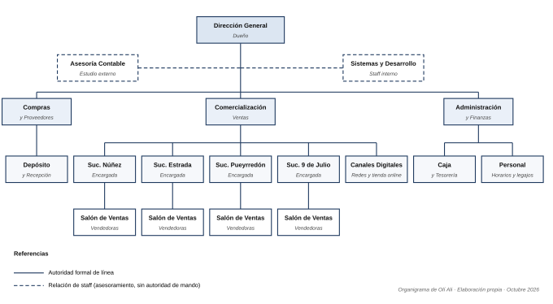

# Entrega 3 · Estructura formal y diseño de datos

## Organigrama

Estructura **lineal con staff** y **centralizada**. La departamentalización es funcional en el nivel táctico (Compras, Comercialización, Administración) y geográfica en Comercialización (una unidad por sucursal). Sistemas y Desarrollo es staff: informa y recomienda, pero no da órdenes, lo que respeta la unidad de mando.

## Diccionario de datos

Tipos lógicos: `String(n)`, `Integer`, `Decimal(p,d)`, `Date`, `DateTime`, `Boolean`. Las cantidades se miden en unidades.

### PROVEEDOR

| Campo | Tipo | Clave | Descripción |
|---|---|---|---|
| id_proveedor | Integer | PK | Identificador único |
| razon_social | String(100) | | Nombre legal |
| cuit | String(13) | | CUIT con guiones |
| contacto | String(60) | | Persona y teléfono para pedidos |
| plazo_entrega_dias | Integer | | Días promedio entre el pedido y la recepción |
| activo | Boolean | | Si sigue trabajando con Olí Ali |

### ARTICULO

| Campo | Tipo | Clave | Descripción |
|---|---|---|---|
| id_articulo | Integer | PK | Identificador interno |
| codigo_dragonfish | String(20) | | Código único en Dragonfish; clave de importación |
| descripcion | String(120) | | Nombre comercial |
| categoria | String(40) | | Jean, remera, buzo, niños, bebé |
| talle | String(10) | | Talle |
| color | String(30) | | Color |
| temporada | String(10) | | Por ejemplo, "OI-2026" |
| id_proveedor | Integer | FK | Referencia a PROVEEDOR |
| precio_costo | Decimal(12,2) | | Último costo (informativo) |

### SUCURSAL

| Campo | Tipo | Clave | Descripción |
|---|---|---|---|
| id_sucursal | Integer | PK | Identificador único |
| nombre | String(50) | | Núñez, Estrada, Pueyrredón, 9 de Julio |
| direccion | String(120) | | Dirección |
| encargada | String(60) | | Quién recibe las alertas |
| fecha_apertura | Date | | Evita comparar meses en los que no existía |
| activa | Boolean | | Si está operando |

### VENTA_DETALLE

| Campo | Tipo | Clave | Descripción |
|---|---|---|---|
| id_linea | Integer | PK | Renglón de venta |
| nro_comprobante | String(20) | | Ticket o factura en Dragonfish |
| fecha_hora | DateTime | | Momento de la venta |
| id_sucursal | Integer | FK | Referencia a SUCURSAL |
| id_articulo | Integer | FK | Referencia a ARTICULO |
| cantidad | Integer | | Unidades; negativo = devolución o cambio |
| precio_unitario | Decimal(12,2) | | Precio cobrado |
| canal | String(15) | | "salón" u "online" |
| id_importacion | Integer | FK | Referencia a IMPORTACION |

### STOCK

| Campo | Tipo | Clave | Descripción |
|---|---|---|---|
| id_stock | Integer | PK | Registro de existencia |
| id_articulo | Integer | FK | Referencia a ARTICULO |
| id_sucursal | Integer | FK | Referencia a SUCURSAL |
| cantidad_actual | Integer | | Unidades disponibles |
| stock_minimo | Integer | | Umbral de reposición |
| en_alerta | Boolean | | `cantidad_actual < stock_minimo` |
| fecha_actualizacion | DateTime | | Último dato importado |

### IMPORTACION

| Campo | Tipo | Clave | Descripción |
|---|---|---|---|
| id_importacion | Integer | PK | Corrida de importación |
| fecha_hora_inicio | DateTime | | Inicio |
| archivo_origen | String(150) | | Archivo exportado de Dragonfish |
| duracion_segundos | Integer | | Meta: ≤ 300 s |
| registros_procesados | Integer | | Líneas cargadas |
| registros_rechazados | Integer | | Líneas con error |
| estado | String(15) | | "OK", "Con errores" o "Fallida" |

**Relaciones:** PROVEEDOR 1:N ARTICULO · ARTICULO 1:N VENTA_DETALLE · SUCURSAL 1:N VENTA_DETALLE · ARTICULO N:M SUCURSAL resuelta por STOCK · IMPORTACION 1:N VENTA_DETALLE.
