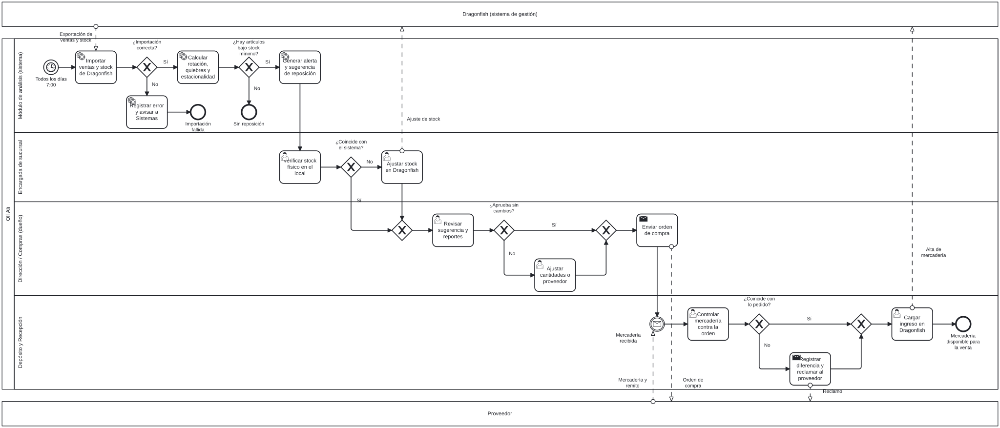

# Entrega 4 · Procesos, trabajo colaborativo y control

## 1. Proceso de negocio (BPMN)

**Proceso modelado:** reposición de mercadería basada en datos (situación futura, *TO-BE*).
**Archivos:** [`reposicion-oli-ali.bpmn`](../diagramas/reposicion-oli-ali.bpmn) (BPMN 2.0, se abre en bpmn.io o Camunda Modeler) y [`reposicion-oli-ali.svg`](../diagramas/reposicion-oli-ali.svg).

### Situación actual (AS-IS)

Hoy no existe un proceso formal. El dueño recorre los locales o recibe comentarios de las encargadas, mira el stock en Dragonfish cuando puede y decide la compra según su criterio. No hay disparador fijo, ni control de lo recibido contra lo pedido, ni registro de por qué se compró lo que se compró.

### Situación futura (TO-BE)

| Elemento | En el diagrama |
|---|---|
| **Pools** | *Olí Ali* (proceso interno), *Dragonfish* y *Proveedor* (actores externos, como pools colapsados) |
| **Lanes** | Módulo de análisis (comportamiento automatizado del sistema), Encargada de sucursal, Dirección / Compras (dueño), Depósito y Recepción |
| **Evento de inicio** | Temporizador: todos los días a las 7:00 |
| **Compuertas exclusivas** | ¿Importación correcta? · ¿Hay artículos bajo stock mínimo? · ¿Coincide con el sistema? · ¿Aprueba sin cambios? · ¿Coincide con lo pedido? |
| **Flujos de mensaje** | Exportación de ventas y stock, ajuste de stock, orden de compra, mercadería y remito, reclamo, alta de mercadería |
| **Eventos de fin** | Importación fallida · Sin reposición · Mercadería disponible para la venta |

**Flujo estándar:** el módulo importa los datos de Dragonfish, calcula los indicadores y detecta los artículos bajo stock mínimo. La encargada verifica el stock físico, el dueño revisa la sugerencia y envía la orden de compra, y Depósito recibe, controla y carga el ingreso en Dragonfish.

**Excepciones contempladas:** importación fallida (se registra el error y se avisa a Sistemas, sin cargar datos parciales), diferencia entre el stock físico y el del sistema (se ajusta en Dragonfish antes de decidir), pedido modificado por el dueño, y mercadería que no coincide con la orden (se registra la diferencia y se reclama al proveedor).

## 2. Trabajo colaborativo y control de versiones

| Práctica | Cómo se aplica |
|---|---|
| Rama principal | `main` solo recibe cambios por Pull Request revisado |
| Ramas secundarias | `docs/entregas-1-a-3` y `docs/entrega-4` |
| Mensajes de commit | Formato *Conventional Commits* en español: `tipo(alcance): descripción en infinitivo` (por ejemplo, `docs(bpmn): agregar modelo del proceso de reposición`) |
| Pull Requests | Cada rama se integra con un PR que describe el cambio, referencia los *issues* que cierra y se fusiona después de la revisión |
| Trazabilidad | Los PR cierran *issues* (`Closes #n`), lo que mueve automáticamente la tarjeta a **Listo** en el tablero |

## 3. Backlog ágil

Ver [`backlog/historias-de-usuario.md`](../backlog/historias-de-usuario.md). El tablero de GitHub Projects tiene tres columnas (**Por hacer**, **En progreso**, **Listo**) y combina las tres historias de usuario con las tareas del Gantt de la Entrega 2.

## 4. Mecanismos de control

Los estándares salen de las metas cuantitativas de la Entrega 2 y se miden con los campos del diccionario de datos de la Entrega 3.

### Indicadores técnicos (auditoría del sistema)

| # | Indicador | Cálculo | Estándar | Frecuencia | Tipo de control |
|---|---|---|---|---|---|
| 1 | Tiempo de importación | `IMPORTACION.duracion_segundos` | ≤ 300 s | Diaria | Concurrente |
| 2 | Tasa de rechazo | `registros_rechazados / (procesados + rechazados)` | ≤ 0,5 % | Diaria | Preventivo |
| 3 | Disponibilidad de datos | Importaciones con estado "OK" / días del mes | ≥ 95 % | Mensual | Retroalimentación |
| 4 | Precisión de conciliación | Unidades vendidas en el módulo / unidades en Dragonfish | ≥ 99,5 % | Mensual | Retroalimentación |
| 5 | Oportunidad de alertas | Hora de la alerta − `STOCK.fecha_actualizacion` | ≤ 24 h | Diaria | Concurrente |
| 6 | Tiempo de respuesta | Tiempo de carga de cada reporte (percentil 95) | ≤ 3 s | Semanal | Concurrente |
| 7 | Escalabilidad | Prueba de carga con 3 años de histórico y 6 sucursales | Sin rediseño, cumple el indicador 6 | Antes de producción | Preventivo |

### Indicadores de gestión (impacto en la organización)

| # | Indicador | Cálculo | Estándar | Frecuencia |
|---|---|---|---|---|
| 8 | Quiebres de stock | Artículos con `en_alerta = true` / artículos activos, por sucursal | Bajar 30 % respecto de la línea base en 6 meses | Mensual |
| 9 | Adopción | Órdenes de compra que parten de una sugerencia del sistema / órdenes totales | ≥ 80 % a los 3 meses | Mensual |
| 10 | Diferencias en recepción | Recepciones con diferencia / recepciones totales, por proveedor | Seguimiento; base para evaluar proveedores | Mensual |

### Ciclo de control

1. **Establecer estándares:** las tablas anteriores.
2. **Medir:** el propio módulo guarda los datos (tabla `IMPORTACION`, fechas de `STOCK`, órdenes de compra).
3. **Comparar:** un tablero de control muestra cada indicador en verde (cumple), amarillo (a menos de 10 % del límite) o rojo (no cumple).
4. **Corregir:** un rojo en los indicadores 1 a 5 abre automáticamente un *issue* en este repositorio; un rojo en 8 a 10 se revisa con el dueño en la reunión mensual de compras.
